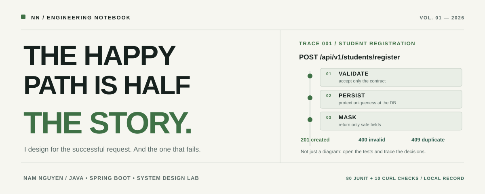

<!--
  THE HAPPY PATH IS HALF THE STORY
  Personal engineering notebook for Nam Nguyen.
  This README favors inspectable work over badges and generated counters.
-->

<picture>
  <source media="(prefers-color-scheme: dark)" srcset="./assets/hero-dark.svg">
  <source media="(prefers-color-scheme: light)" srcset="./assets/hero-light.svg">
  
</picture>

<sub>NGUYỄN VƯƠNG QUỐC NAM &nbsp; / &nbsp; FPT UNIVERSITY &nbsp; / &nbsp; SOFTWARE ENGINEERING</sub>

<br><br>

**Most demos stop at `200 OK`. I want to understand the rest.**

I build and study web systems with Java, Spring Boot, and modern frontend tools. My interests tend to lead me beyond the visible screen: API contracts, data integrity, concurrency, and what happens when a request doesn't go as planned.

**[01 / Field notes](#01--field-notes)** &nbsp;·&nbsp; **[02 / Systems in progress](#02--systems-in-progress)** &nbsp;·&nbsp; **[03 / Contact](#03--open-a-conversation)**

---

## 01 / Field notes

### Case 001 — When two valid requests arrive together

**Student OJT Registration** · Java 21 / Spring Boot / JPA / H2

An API isn't reliable just because its happy path returns `201`. Two registration requests can both pass a preliminary duplicate check before either reaches the database.

```text
REQUEST A ──┐
            ├── both pass "not registered yet"
REQUEST B ──┘
                 ↓
           DATABASE UNIQUE RULE
                 ↓
          201 CREATED  /  409 CONFLICT
```

**What this repository demonstrates:**

- Validation isn't the same as data integrity. Database constraints still matter.
- An API response should protect personal information: phone and national ID values are masked.
- Failures have contracts too: invalid data `400`, duplicate record `409`, missing record `404`.
- Concurrency deserves a real test, not a hopeful assumption.

**Evidence, not slogans:** the repository documents **80 JUnit tests passing and 10/10 local cURL checks** on **29 Oct 2026**. These are recorded local verification results, **not** a claim of production performance or code coverage.

[Explore source](https://github.com/namquoc130425/Student-OJT-Registration) · [Architecture decisions](https://github.com/namquoc130425/Student-OJT-Registration/blob/main/docs/ARCHITECTURE.md) · [Verification report](https://github.com/namquoc130425/Student-OJT-Registration/blob/main/docs/STEP_5_VERIFICATION.md)

---

### Case 002 — A system is more than a service

**Spring Boot Microservices** · Service Discovery / Config Server / API Gateway / Java 21

A hands-on lab for understanding how independently running services find each other, share configuration, and build reliably.

The repository separates services into their own modules and CI jobs. I am interested in the trade-offs here: **what should be distributed, what should stay simple, and what happens when a dependency is unavailable?**

[Explore lab](https://github.com/namquoc130425/Spring-Boot-Microservices) · [Read CI notes](https://github.com/namquoc130425/Spring-Boot-Microservices/blob/main/docs/ci.md)

---

### Case 003 — The uncomfortable questions before release

**AITaster Backend** · Code review / Wallet workflows / Webhooks

Some of the most important engineering work begins with questions rather than features:

> What prevents a retried payment webhook from crediting an account twice?  
> What happens if two requests try to spend the same balance concurrently?  
> Which endpoint exposes more data than its caller should see?

My [release review notes](https://github.com/namquoc130425/AITaster_BE/blob/main/CODE_REVIEW_RELEASE_V0_6.md) investigate these risks and propose changes. This is a **review artifact** — not proof that every recommended fix has already been implemented.

[Explore repository](https://github.com/namquoc130425/AITaster_BE) · [Read the review](https://github.com/namquoc130425/AITaster_BE/blob/main/CODE_REVIEW_RELEASE_V0_6.md)

---

## 02 / Systems in progress

```text
CURRENTLY EXPLORING
├─ Java & Spring Boot       API design, transactions, tests
├─ Distributed systems     Gateway, discovery, configuration
├─ React / TypeScript      Clear interfaces, meaningful feedback
└─ Engineering discipline  CI, code review, documented decisions
```

I don't want a wall of logos to stand in for experience. The repositories above are where the details live — including unfinished work, decisions I might revisit, and problems I'm still learning to solve.

<details>
<summary><b>Three questions I'm keeping open</b></summary>
<br>

1. How do you make a repeated request safe by design rather than by accident?
2. What should a client know when the server fails, without revealing sensitive internals?
3. When does a microservice boundary solve a real problem — and when does it merely add complexity?

</details>

---

## 03 / Open a conversation

If you've found a flaw in my reasoning, a better design, or an interesting problem worth building, I'd like to hear it.

**[Email me](mailto:namquoc725@gmail.com)** &nbsp;·&nbsp; **[Browse my repositories](https://github.com/namquoc130425?tab=repositories)**

<sub>Built as a technical field notebook, not a trophy shelf. Updated as the work changes.</sub>
